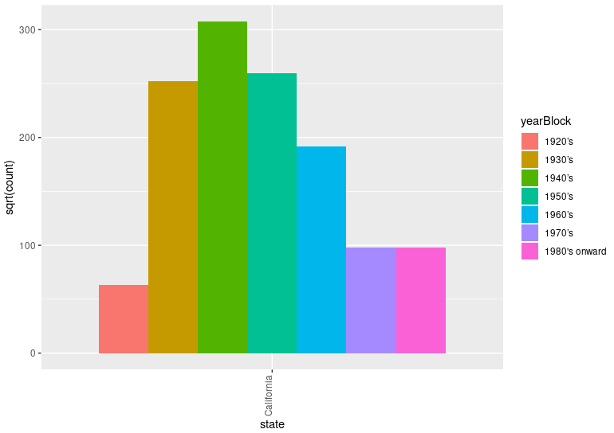

# Data Science (CS301) Lab 06 Assignment

**Vaccine Efficacy: Evidence, Models, and Ethics**

Fall 2026

- __Assigned__: Thursday, 12th November 2026  
- __Due__: Thursday, 19th November 2026  
- __Lab Expiration Date__: Thursday, 26th November 2026

Note: This is a Group work assignment. Group sizes are 1 to 3 members.

## Objectives

The goals of this group assignment are to:

+ Explore patterns in U.S. contagious disease data before and after vaccine introductions.
+ Build clear plots and use at least two course methods to investigate vaccine-related research questions.
+ Evaluate how method choices, assumptions, and limitations affect the trustworthiness of results.
+ Consider ethical responsibilities in data science and the consequences of research misconduct.
+ Communicate findings in a short presentation.

## Research Context

The `us_contagious_diseases` data in the R package `dslabs` contains disease counts reported by U.S. state and year, along with population and reporting-week information. In this lab, use the data to investigate changes around 1963, when a measles vaccine became available in the United States.

Treat 1963 as a useful point of comparison, not proof that every disease or state began vaccination in that year. Vaccine introduction and uptake differed by disease and place. The dataset is observational: a before-and-after pattern can be consistent with vaccine impact, but by itself does not establish that vaccination caused the pattern. Please consider other explanations, or other methods of analysis to create some irrefutable evidence for the benefits of vaccines. Note, you will likely come across problems in your analysis (e.g., limitations in your data, a difference in case counts between states, different sized populations to compare and similar) that will have to be addressed during your analysis to create your evidence.

## Finding Trends in the Data

The questions below are prompts to address and investigate, not conclusions you are expected to confirm. Instead, you are to build an argument in the form of a body of evidence made up of plots, statistics and the results of models to support or refute the trends in the data. 

Note: this body of evidence will also be used in your presentation to stake your claims about patterns that the data does and does not support.

### Questions to Address

1. Does 1963 appear to be a change point in the frequency or rate of measles or other diseases?
3. Is there evidence of a sustained decrease in reported illness after the relevant vaccine introduction?
4. Before vaccine introduction, were disease occurrences widespread across states, or concentrated in a subset of states?
5. Do state-level patterns suggest that outbreaks slowed after vaccine introduction?
6. How much do disease patterns and changes vary among states? Do all states show the same direction or degree of change?
7. Overall, how do disease outcomes compare between periods before and after vaccine introduction, and how strong is the evidence for vaccine effectiveness?

## Getting Started

Open [src/analysis.R](src/analysis.R) in RStudio. The starter script clears the workspace and plots, loads `dslabs` and `tidyverse`, and makes the dataset available as `dat`. Run the script once, then add your analysis in the indicated sections. Note:  For online help, type `?dslabs::us_contagious_diseases` to review the dataset documentation (the "codebook") which will explain the data and provide its reference. Nifty, right?!

Exploring the dataset, you will notice that the dataset is rich in possibilities to work with. For example it includes `disease`, `state`, `year`, `weeks_reporting`, `count`, and `population`. Inspect the columns and then decide what transformations or subsets are appropriate for your questions. You will likely find that using multiple columns might be helpful for your work. For example, consider whether comparing raw counts is fair when state populations differ, and how to handle missing values or years with incomplete reporting.

## Part 1. Analysis and Code

Complete your analysis in `src/analysis.R`. Your group is responsible for making its own choices about the analysis. Please be sure that your approach, using methods from class or ones that you have researched on your own, are able to address the research questions of this work. Include clear plots that support your interpretations from your models and other work.

1. Explore the data. Identify relevant diseases, years, states, and variables, and explain any filtering or transformations you use.
2. Choose and apply at least **two different methods** covered in class: ANOVA, MANOVA, regression, decision trees or something else. For instance, you may decide to use additional methods to address your research questions.
3. Use your methods to investigate the research questions. Please be sure to explain what each method estimates, compares, or predicts, and why it is appropriate for your specific question and data.
4. Create and label plots that make your findings understandable and relatable to the project. Explain what the plots show and how they relate to the model results.
5. Check relevant assumptions and limitations as you set up your models (e.g., test your hypotheses or similar). Depending on your methods, consider sample size, dependence among repeated state-year observations, missing data, model fit, influential observations, validation, and uncertainty.
6. Distinguish evidence of association or a before-and-after difference from evidence of causation. Do not claim that a method proves vaccine efficacy if the data and design do not support that conclusion.

### A Proper Piece of Programming

Your instructor will be running at your code to marvel at your groups amazing skill; Please be sure that your code (all that you submit) runs from the beginning to the end **without execution problems**.

Please include comments to explain your thinking of your code, and to cover the  not-so-obvious analysis decisions. 

## Part 2. Analysis Reflection

Done with your analysis? Now it is time work with your group to complete [writing/reflection.md](writing/reflection.md.

For this part, please be sure to discuss each question as a group. When writing your discussions, be sure to answer each question in *clear and meaningful language* and refer to your own plots, methods, and results.

## Part 3. Reading and Research Ethics

Done with your Reflection document? It is now time to address the reading element of this work.

Read Gardiner Harris's article, [_Journal Retracts 1998 Paper Linking Autism to Vaccines_](https://www.nytimes.com/2010/02/03/health/research/03lancet.html). A copy/reference is also included in [inspiration/lab05/reading/](inspiration/lab05/reading/BritishJournalRetractsPaperLinkingAutismAndVaccines-TheNewYorkTimes.md). The article is provided as a text file in `reading/` in case there is a login to complete at the publisher's site.

Once you have read the article, you will have an idea about what could go wrong (in terms of ethics) in data science research. In this part, you and your group are to use online search engines to find **two additional articles** describing alleged or established ethical violations in data science or data-driven research which you will write about in your reflection document.

Please select *credible sources*, distinguish documented facts from allegations or opinions, and provide full references. Complete both case studies in [writing/reflections.md](writing/reflections.md).

## Part 4. Group Presentation

Work in a group of **one to three students** during our next lab meeting. Each group will give a **five- to six-minute presentation with slides**. Your presentation should:

- Introduce the research questions and the data you used.
- Present findings and plots from at least two different course methods.
- Explain how the relevant parts of your code work and what each method does.
- Discuss why your results are or are not trustworthy, including assumptions and limitations.
- Briefly discuss the two data-science ethics articles.
- Give every group member a speaking role.

Please plan your presentation so the required analysis and ethics discussion fit within the time limit of about 5 or six minutes. Slides should be readable, contain plots, and should discuss the method used as it relates to the data and sources that were used. 

**Note, it will be difficult or impossible to reschedule your presentation if you do not present during your allotted time. It is therefore strongly recommended that your group does not miss its presentation time.**

## Required Deliverables

+ Completed and executable R analysis in `src/analysis.R`.
+ Completed group responses in `writing/reflection.md`.
+ Completed ethics case studies and references in `writing/reflections.md`.
+ A five- to six-minute slide presentation in which every group member speaks.

Note: it is not necessary to submit your slides.

Another note: Be sure to include each group member's name and the date on the written work and slides. 

## Project Assessment

The grade that a student receives on this assignment will have the following components.

* **Presented work[up to 25%]:** It is essential that students of the course are able to articulate a research project. For this students are to present their work using slides, graphics and information to highlight their efforts. Be sure that slides contain no grammatical or spelling errors which detract from the excitement of the work. In addition, please ensure that everything that is provided in the slides (e.g., plots, data, analysis and similar) can be fully explained or discussed without difficulty.

* **Mastery of Technical Knowledge and Skills [up to 50%]:** Students will receive a portion of their assignment grade when their program implementation reveals that they have mastered all of the technical knowledge and skills developed during the completion of this assignment. As a part of this grade, the instructor will assess aspects of the programming including, but not limited to, the completeness and the correctness of the program and the use of effective source code comments.

* **Mastery of Technical Writing [up to 25%]:** Students will also receive a checkmark grade when the responses to the writing questions presented in the `reflection.md` reveal a proficiency of both writing skills and technical knowledge. To receive a checkmark grade, the submitted writing should have correct spelling, grammar, and punctuation in addition to following the rules of Markdown and providing conceptually and technically accurate answers.

### Checks for GatorGrade

For immediate feedback, we use GatorGrade to report missing components. You will see a red X that turns into a green check mark when all components are included. Click on the red X to see a listing of the components to address.

You can also run it locally (install with `pipx install gatorgrade`):

`gatorgrade --config config/gatorgrade.yml`

## Seeking Assistance

* Extra resources for using markdown include;
  + [Markdown Tidbits](https://www.youtube.com/watch?v=cdJEUAy5IyA)
  + [Markdown Cheatsheet](https://github.com/adam-p/markdown-here/wiki/Markdown-Cheatsheet)

If you have questions, please ask the Technical Leaders or the instructor.